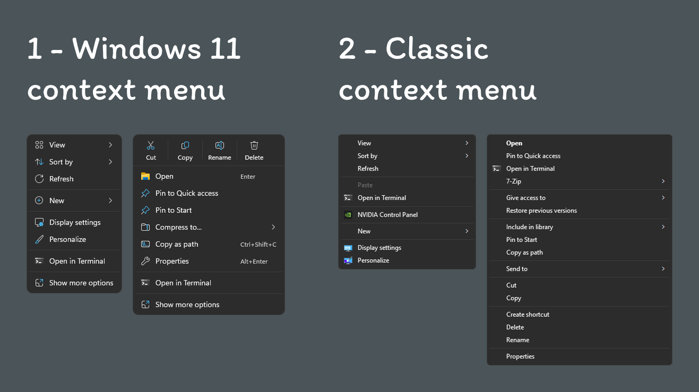
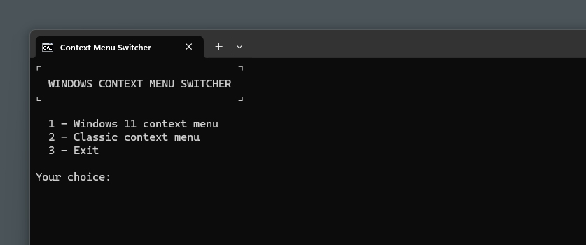

# Windows 11 Context Menu Switcher

**Context menu comparison — Windows 11 vs Windows 10, on the desktop and on a folder:**

<p align="center">
  
</p>

## What it does

Windows 11 ships with a redesigned context menu that hides many useful entries behind "Show more options". This script toggles that behavior by writing (or deleting) a single registry key under `HKCU`:

```
HKCU\Software\Classes\CLSID\{86ca1aa0-34aa-4e8b-a509-50c905bae2a2}\InprocServer32
```

- **Option 1 – Windows 11 context menu** — removes the key, restoring the default Windows 11 menu.
- **Option 2 – Classic context menu** — creates the key, bringing back the Windows 10-style menu.

After applying a change, the script restarts `explorer.exe` so the new menu takes effect immediately.

**The script itself (Command Prompt):**

<p align="center">
  
</p>

## Requirements

- Windows 11
- No administrator rights needed (changes affect the current user only)

## Usage

1. Download `Classic-Right-Click-Color.bat`.
2. Double-click it.
3. Choose an option from the menu:
   - `1` — Windows 11 context menu
   - `2` — Classic context menu
   - `3` — Exit

That's it. The window closes automatically after a successful change.

## Notes & warnings

- **Registry modification.** The script only touches `HKCU` (current user). It does not affect other users or the system-wide configuration.
- **Explorer restart.** `explorer.exe` is killed and restarted. This briefly hides the taskbar and closes all open File Explorer windows. Unsaved work in other apps is not affected.
- **Unofficial method.** Microsoft may change or remove this behavior in a future Windows update. If the script stops working, the key will simply have no effect.
- **Antivirus warnings.** Some antivirus tools flag `.bat` files that modify the registry. This is expected — the script is short and you can read every line.
- **Reversible.** Running option `1` returns your system to the default Windows 11 state.

## How to revert manually

If you'd rather undo the change by hand:

1. Press `Win + R`, type `regedit`, press Enter.
2. Navigate to:
   ```
   HKEY_CURRENT_USER\Software\Classes\CLSID\{86ca1aa0-34aa-4e8b-a509-50c905bae2a2}
   ```
3. Delete the whole `{86ca1aa0-34aa-4e8b-a509-50c905bae2a2}` key.
4. Restart Explorer (or sign out and back in).

## License

MIT — see [LICENSE](LICENSE).
